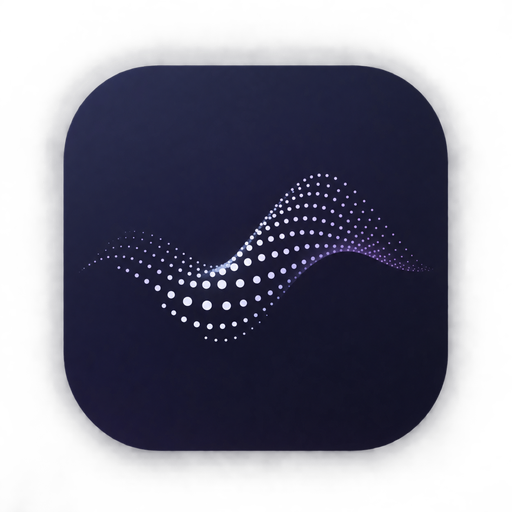
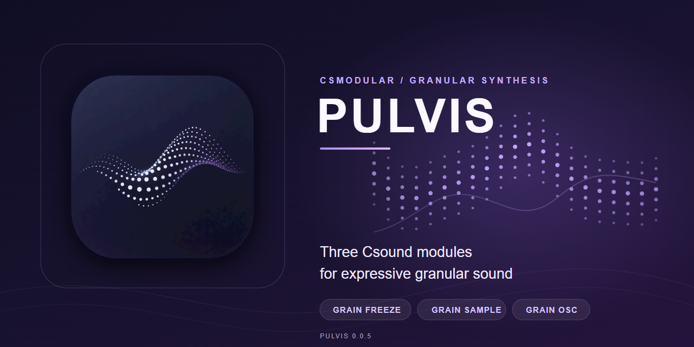

# Пульвис — библиотека гранулярного синтеза для CsModular

[English](README.md) · [简体中文](README.zh-CN.md) · [Русский](README.ru.md)

**«Пульвис» — библиотека гранулярного синтеза для CsModular.**

- **Пульвис · Гранулярная заморозка** записывает и фиксирует живой звук, растягивая голос или аккорды.
- **Пульвис · Гранулярный сэмпл** сканирует WAV, нарезая его на гранулы или меняя высоту.
- **Пульвис · Гранулярный осциллятор** превращает встроенные формы волны в исполняемые гранулярные тембры.

Версия 0.0.5 · Загрузки: [Windows x64 Setup](https://github.com/NJyutong/csmodular-pulvis/releases/download/v0.0.5/Pulvis-0.0.5-windows-x64.exe) · [Пакет Debian для Linux x64](https://github.com/NJyutong/csmodular-pulvis/releases/download/v0.0.5/Pulvis-0.0.5-linux-x64.deb) · [Исходный код](https://github.com/NJyutong/csmodular-pulvis/releases/download/v0.0.5/Pulvis-0.0.5-source.zip) · [SHA-256](https://github.com/NJyutong/csmodular-pulvis/releases/download/v0.0.5/SHA256SUMS.txt)

Все три модуля используют широкоформатную (`500 × 300`) матовую графитовую аппаратную панель с двумя секциями (`PulvisPanel.js`), верхним дисплеем в реальном времени (осциллограмма Csound и БПФ-спектр с окном Ханна на 2048 точек для первого подключённого аудиовыхода плюс предпросмотр огибающей гранулы) и поддержкой HiDPI-рендеринга холста хоста:

- **Пульвис · Гранулярная заморозка** (3 × 3 слева + 3 × 3 справа): левая секция — **Кольцевой буфер и ядро гранул** (`Заморозка`, `В прошлое`, `Разбр. буф.`, `Гранул/с`, `Длина, мс`, `Окно`, `Источник`, `Обратная связь`, кнопка `Снимок` / в метаданных `Сохранить снимок`); правая секция — **Высота, микс и тайминг** (`Высота, пт`, `Разбр. выс.`, `Зерно`, `Микс`, `Разбр. пан.`, `Уровень, дБ`, `Панорама`, `Разбр. вр.`, `Направл.`).
- **Пульвис · Гранулярный осциллятор** (3 × 3 слева + 2 × 3 по центру справа): левая секция — **Осциллятор, фаза и ядро гранул** (`Волна`, `Деф. фазы`, `Высота (A3)`, `Гранул/с`, `Длина, мс`, `Окно`, `Фикс. фазы`, `Направл.`, `Разбр. вр.`); правая секция — **Разброс фазы/высоты и стерео** (`Разбр. фазы`, `Разбр. выс.`, `Зерно`, `Панорама`, `Разбр. пан.`, `Уровень, дБ`). Деформация и разброс фазы по умолчанию равны 0; `Деф. фазы` меняет гармоники цикла, `Фикс. фазы` удерживает глубину, а `Разбр. фазы` задаёт случайное начало каждой гранулы.
- **Пульвис · Гранулярный сэмпл** (симметричная сетка 3 / 3 / 2 слева и справа): в верхней полосе дисплея переключаются слоты `#1`–`#8`, на пустом слоте по центру отображается кнопка **Открыть WAV…** (встроенного демо-WAV нет), а после загрузки — осциллограмма и спектр; левая секция — **Слот WAV, скан и ядро гранул** (`Слот`, `Позиция`, `Скан %/с`, `Гранул/с`, `Длина, мс`, `Окно`, `Фикс. поз.`, `Направл.`); правая секция — **Разброс высоты и стереовыход** (`Высота, пт`, `Разбр. поз.`, `Разбр. выс.`, `Панорама`, `Разбр. пан.`, `Уровень, дБ`, `Разбр. вр.`, `Зерно`).

## Первый запуск

Щёлкните правой кнопкой мыши по заголовку любого модуля Пульвис:

- **О модуле** открывает по центру экрана окно с сайтом проекта, версией, сведениями об авторских правах и лицензией MIT.
- **Язык** (скруглённый выпадающий список) переключает все панели и контекстные меню модулей Пульвис между русским, упрощённым китайским и английским; выбор сохраняется на устройстве, а пункт **Как в системе** возвращает язык браузера (английский по умолчанию). Основной браузер модулей хоста (`Пробел` или ПКМ по пустому холсту) намеренно остаётся на английском (`Pulvis`, `Pulvis Grain Freeze`, `Pulvis Grain Osc`, `Pulvis Grain Sample`), чтобы соответствовать англоязычному меню хоста.
- **Цвет панели** тонирует матовый корпус и акцентный цвет модуля по 32 оттенкам палитры, а кнопка **↺ Как в теме** сразу возвращает исходную графитовую схему.

Для широких панелей и этих меню нужна сборка хоста с текущим патчем интеграции.

Соедините выходы Л/П Grain Osc со входами Л/П Outs2. Убавьте громкость и нажмите ▶.

Исходный код плагина и приложение CsModular хранятся в отдельных репозиториях.

Сначала установите хост CsModular, затем установите плагин Pulvis. После установки просто откройте CsModular — плагин автоматически появится в списке модулей хоста. Нажмите пробел (или ПКМ по пустому холсту) и добавьте модули из библиотеки `Pulvis` (`Pulvis Grain Freeze`, `Pulvis Grain Sample`, `Pulvis Grain Osc`), либо загрузите пример `pulvis-demo.json` (устанавливается в `public/patches/pulvis-demo.json` хоста).

- Левый выход Grain Osc → аудиовход Grain Freeze; выходы Л/П → входы L/R Outs2. Включите звук.
- После записи переключите `Заморозка` с «Запись» на «Стоп», нажмите **Снимок** и выберите в `Источник` вариант «Снимок». Кольцевой буфер можно снова перевести в запись — снимок останется прежним.
- Grain Sample: выберите слот `#1`–`#8` (на дисплее или ручкой `Слот`), нажмите кнопку **Открыть WAV…** на пустом слоте или щёлкните ПКМ по модулю → **Загрузить WAV**, затем подключите выходы Л/П к Outs2. Пустые слоты молчат; встроенный демо-файл не поставляется.
- Плотность Freeze/Sample — 0–24 гранулы/с, Osc — 0–48; значения по умолчанию — 12 и 24. Длина — 2–400 мс. Для живого сигнала длина гранулы может уменьшаться ради безопасности кольцевого буфера. CV на максимуме добавляет 24 или 48 гранул/с соответственно.
- Разброс времени триггера — 0–100%. При 0 ритм регулярный; при 100 события смещаются не более чем на ±45% номинального интервала, сохраняя среднюю плотность. Seed повторяет последовательность, отдельный CV-вход модулирует разброс.
- Окно: 0 — Hann, 1 — треугольное, 2 — Blackman. Направление гранул (вперёд/назад) доступно во всех трёх модулях.
- Источник Freeze: живой кольцевой буфер или последний снимок, приватный для этого экземпляра. Обратная связь 0–0,95 по умолчанию равна 0; при записи она возвращает влажные гранулы в буфер и ограничивает записываемый сигнал уровнем ±1. Пустой буфер и таблицу, всё ещё занятую старой гранулой, сохранить нельзя.

Общее ядро остаётся линейным. Обёртки ограничивают выход до ±1; при превышении полного уровня это жёсткое ограничение. Уровень −12 дБ у самостоятельных источников оставляет около 3 дБ дополнительного запаса при суммировании гранул.

При повышении высоты Sample и Freeze используют sinc-интерполяцию с ограничением полосы; Osc выбирает набор гармоник по максимальной высоте. Отдельно измерены интерполяционное зеркало и наложение выше Найквиста: зеркало 18 кГц рядом с полезным тоном 6 кГц снизилось с −35.2 до −101.1 dBc. При +48 полутонах и 48 кГц компонент WAV 8 кГц, складывающийся в 16 кГц, снизился с −1.2 до −114.2 dBc для Sample и до −113.5 dBc для Freeze.

Каждый Freeze хранит кольцевой буфер и две приватные таблицы снимков по 8 секунд: всего 1 152 000 кадров таблиц при 48 кГц. Снимки не попадают в WAV-слоты Sample и не сохраняются в проекте; после перекомпиляции или перезапуска снимок нужно создать снова.

Производительность измерена только на одной системе: Intel Core i5-12490F, Node 26.12, Csound 7 beta33 WASM, 48 кГц, ksmps=4. Главная стоимость высокой плотности Osc оказалась в повторном копировании состояний всех активных гранул на каждом управляющем блоке. Теперь копируются только хвосты, чьи слоты могут быть повторно использованы в текущем блоке. Раннее парное измерение стресс-сценария 120 гранул/с × 400 мс снизилось с 80.3% до 62.2%; последняя медиана пяти прогонов — 65.3% (959–1,033 мс для рендера 1.5 секунд). Текущие медианы: Osc по умолчанию (24 гранулы/с, 80 мс) — 13.2%; один/два Osc по 48 гранул/с и 400 мс — 35.3%/70.6%; один/два Sample при +48 полутонах и 24 гранулах/с × 400 мс — 36.4%/71.5%; активная часть Freeze после заполнения 8-секундного буфера — 27.9% после вычитания затрат записи. RMS/пик одного Osc по умолчанию — 0.0859/0.1791, двух Osc с максимальной плотностью — 0.4402/0.8785. Две таблицы снимка Freeze добавляют около 6.16 МБ линейной памяти WASM; 20 копирований заняли дополнительно 7.85 мс. Это время офлайн-рендера относительно длительности аудио, а не загрузка всей системы и не проверка звукового callback.

На всех компьютерах диапазон плотности одинаков: 0–24 гранулы/с у Freeze/Sample и 0–48 у Osc. Плагин не видит срок обработки аудиобуфера и не настраивает эти пределы по устройству. Реальный запас зависит от процессора, размера аудиобуфера, нагрузки хоста и браузера и других модулей. Эти числа относятся только к указанной системе; перечисление звуковых устройств Windows было отклонено системой, поэтому прослушивание и измерение realtime-прерываний не проводились. При прерываниях уменьшите Density, Size или число экземпляров.

Один WAV: до 256 МиБ и 5 минут. Весь сеанс: до 512 МиБ исходных файлов и 48 миллионов декодированных монофонических кадров.
Поддерживаются моно/стерео WAV 8–192 кГц, PCM 8/16/24/32 бит, IEEE float32/64 и стандартный расширенный WAV. У стереофайлов используется левый канал. RF64 и WAV с обратным порядком байтов не поддерживаются.
Восемь слотов общие для текущего сеанса. После закрытия или обновления приложения загрузите файлы снова. Замена файла перезапускает аудиодвижок и очищает буферы записи.
Декодирование и вся обработка аудио выполняются в Csound. JavaScript выбирает файл, проверяет заголовок и передаёт данные в виртуальную файловую систему.

Из корня исходников выполните `node scripts/build-modules.mjs`, затем `node scripts/install.mjs <путь-к-копии-CsModular>`.
Архив исходников содержит сценарий установки и файлы для сборки. Тесты и эталонные измерения доступны в Git. Подробная архитектура и ограничения описаны в английском руководстве. Оригинальный движок распространяется по MIT. Источники идей и лицензии перечислены в SOURCES.md.

## Настольные установщики

Версия 0.0.5 включает собственный мастер установки Windows x64 и Debian-пакет для Linux x64. Чистая установка проверена на Windows x64 и Linux x64 с CsModular 0.1.5 (`10136ca`): проверены все три модуля, импорт WAV, маршрутизация Voice/FX, сохранение и повторное открытие проекта, а также удаление. Debian-пакет объявляет системные зависимости, которые устанавливает пакетный менеджер; библиотеки GTK и WebKit в пакет не включены. Пакеты macOS для Apple Silicon и Intel пока не собраны и не проверены на реальных устройствах. Установщик предназначен для CsModular 0.1.5 с интеграцией гранулярного движка и записывает библиотеку в постоянную папку `libraries/pulvis`. При обновлении он переименовывает старую папку `granular` в `pulvis` и меняет индекс библиотеки; интеграция перенаправляет старые проекты с ID `granular` в Pulvis. Windows Setup не требует WebView2 и автоматически выбирает язык интерфейса Windows: китайский, русский или английский по умолчанию.

Загрузки: [установщик Windows x64](https://github.com/NJyutong/csmodular-pulvis/releases/download/v0.0.5/Pulvis-0.0.5-windows-x64.exe) · [пакет Debian для Linux x64](https://github.com/NJyutong/csmodular-pulvis/releases/download/v0.0.5/Pulvis-0.0.5-linux-x64.deb) · [архив исходного кода](https://github.com/NJyutong/csmodular-pulvis/releases/download/v0.0.5/Pulvis-0.0.5-source.zip) · [контрольные суммы SHA-256](https://github.com/NJyutong/csmodular-pulvis/releases/download/v0.0.5/SHA256SUMS.txt).

Чистая установка: подготовьте CsModular 0.1.5 с интеграцией гранулярного движка, где плагин ещё не установлен; закройте хост. В Linux установите пакет командой `sudo apt install ./Pulvis-0.0.5-linux-x64.deb`, затем запустите Pulvis Installer из меню приложений; укажите папку `libraries`, и мастер установит библиотеку в `pulvis`. Пакетный менеджер установит системные зависимости из метаданных Debian; GTK и WebKit не входят в пакет. В Windows запустите Setup и выберите `libraries/pulvis`. Снова откройте CsModular, убедитесь, что в браузере модулей в библиотеке `Pulvis` доступны все три модуля, а на холсте отображаются «Пульвис · Гранулярная заморозка», «Пульвис · Гранулярный сэмпл» и «Пульвис · Гранулярный осциллятор». Загрузите WAV в сэмпл, затем создайте проект, сохраните и откройте его снова. В Windows удалите плагин через список установленных приложений или запустите `unins000.exe` в папке плагина. В Debian сначала удалите плагин через Pulvis Installer, затем при необходимости выполните `sudo apt remove pulvis-installer`.

Запись приёмки версии 0.0.5 содержит точную базу хоста, хеши установленных файлов, результат сохранения и повторного открытия проекта, охват проверок и известные проблемы хоста. Физическая петля аудио не проверялась.

## Сборка, файлы и временные данные

Запустите `npm run build:windows-installer` в Windows или `npm run build:linux-deb` в Linux. Проверенный пакет и его файл `.sha256` сохраняются в `release-assets/<version>/`; когда готовы все три пакета, команда `npm run release:checksums` создаёт `SHA256SUMS.txt`. Перед публикацией сборщик повторно читает пакет и проверяет его SHA-256.

Каждая сборка получает отдельный временный каталог (Windows: `D:\csmodular-tools\pulvis-builds`; WSL: `/mnt/d/csmodular-tools/pulvis-builds`; нативный Linux: системный каталог временных файлов). После успешной проверки удаляется только каталог этой сборки. При ошибке вывод команд и диагностика сохраняются в `test-results/build-logs/`, затем удаляются восстанавливаемые промежуточные файлы текущей сборки.

CI хранит отдельный каталог задачи до загрузки пакета и его контрольной суммы. При ошибке сначала загружаются журналы; заключительный шаг удаляет только каталог текущей задачи. Подробности приведены в [описании сборки и очистки](docs/BUILDING.md).
